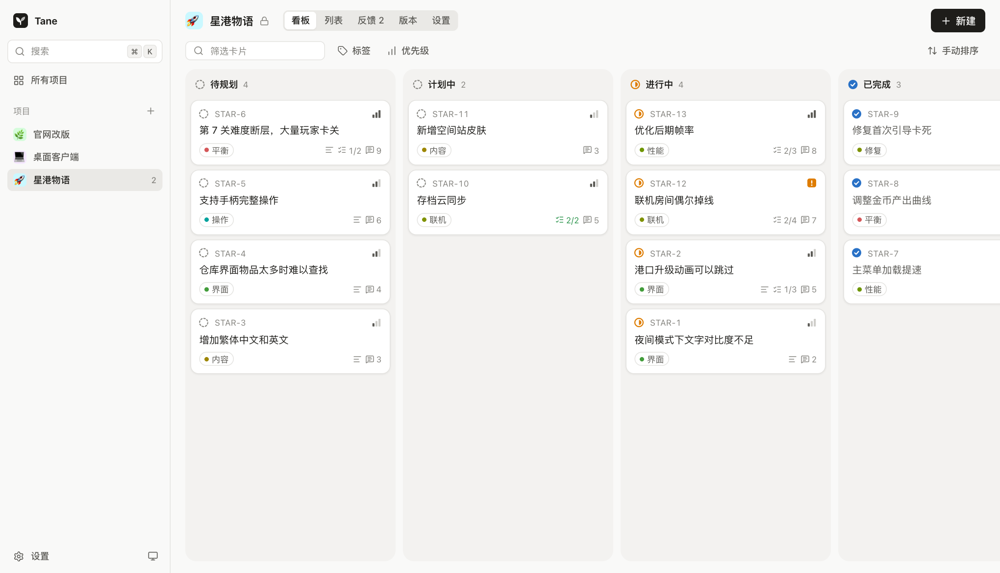

<p align="center">
  
</p>

<h1 align="center">Tane</h1>

<p align="center">
  A small, fast kanban and feedback board that your own AI agent can operate.
</p>

<p align="center">
  <a href="https://github.com/dogxii/tane/stargazers"></a>
  <a href="https://github.com/dogxii/tane/commits/main"></a>
  <a href="LICENSE"></a>
  <a href="https://developers.cloudflare.com/workers/"></a>
  <a href="https://svelte.dev"></a>
</p>

<p align="center">
  English | <a href="README.zh-CN.md">简体中文</a>
</p>

<p align="center">
  
</p>

Tane (種, "seed") helps you collect what people ask for and decide what ships next. One owner runs many projects, each private by default. It deploys to your own Cloudflare account.

## Features

- **Board and table views** of the same cards, with drag and drop, keyboard shortcuts and a ⌘K palette
- **Feedback inbox** that skips duplicates and counts mentions by distinct people
- **Feedback page** with its own link, which works while the board stays private
- **Public roadmap and changelog** for any project you choose to open
- **Agent access** with one Markdown file and a token. The site runs no AI and needs no model key
- **Light by design**: about 40 KB of gzipped JS and CSS on the feedback page, and no UI framework

## Quick start

Requires Node 22 or newer.

```bash
git clone https://github.com/dogxii/tane.git
cd tane
npm install
cp .dev.vars.example .dev.vars
npm run db:local
npm run dev
```

Open <http://localhost:5173> and sign in with the local password `admin`.

## Deploy

Tane runs on Cloudflare Workers and D1.

```bash
npx wrangler login
npx wrangler d1 create tane --binding DB --update-config --location apac
npx wrangler secret put ADMIN_PASSWORD
npm run deploy
```

Set `--location` to the region closest to your users: `wnam`, `enam`, `weur`, `eeur`, `apac` or `oc`.

There is no default password in production, so choose a long, random one. Running `secret put` again changes it and signs out every browser session.

Personal use fits comfortably in Cloudflare's free plan, which allows 100,000 API requests and 5 million database rows read per day. Visitors to a public board share a copy cached for five minutes at each edge location, so their traffic barely touches the database.

## Connect your agent

In **Settings**, create a token and paste the line it gives you into your agent. The line points the agent at `/agent.md`, which describes the whole API, so anything that can make HTTP requests can use it. Then ask in plain language, such as "tick off card 42 and note the commit".

If you prefer a command line, `npm link` provides `tane`, a dependency-free wrapper over the same API:

```bash
tane login https://your.site tane_xxx
tane use my-project
tane cards --compact
tane done 42 --reason "shipped in abc123"
```

Run `tane --help` for every command.

## Security and privacy

Every agent change is logged under the token's name, along with any reason the agent gives. These actions stay with the owner on the website:

- Making a project public, and changing submission or feedback page settings
- Revealing a card on the public board. Cards an agent creates start hidden
- Publishing a release, or editing a published one
- Deleting a project, and managing tokens

Public boards show card titles, descriptions, labels, status, checklists, mention counts and published releases. They never show original feedback, comments, activity, keywords, hidden cards or canceled cards. Because the board is cached, a card you hide or a project you make private can stay visible to visitors for up to five minutes. The feedback page is off by default and shows only the project's name and icon.

Feedback is written by strangers, so treat it as untrusted input to your agent. The API returns it under an `untrusted` field and `agent.md` tells agents to treat it as data, but that only reduces the risk of prompt injection. Give an agent that reads feedback only the permissions it needs.

## Development

| Command | Purpose |
|---|---|
| `npm run dev` | Start the app and API locally |
| `npm test` | Run the API tests against a running dev server |
| `npm run check` | Type-check the project |
| `npm run build` | Build for production |

```
worker/          API: auth, projects, cards, feedback
migrations/      D1 schema
src/lib/ui/      Component library (browse it at /ui)
src/components/  Board, list, feedback, releases, card panel
src/pages/       Routes
public/agent.md  Guide your agent reads
cli/tane.mjs     Optional command line
test/            API integration tests
```

Built with [Hono](https://hono.dev) and [Svelte 5](https://svelte.dev).

## Star history

<a href="https://star-history.com/#dogxii/tane&Date">
  <picture>
    <source media="(prefers-color-scheme: dark)" srcset="https://api.star-history.com/svg?repos=dogxii/tane&type=Date&theme=dark" />
    
  </picture>
</a>

## License

[MIT](LICENSE)
