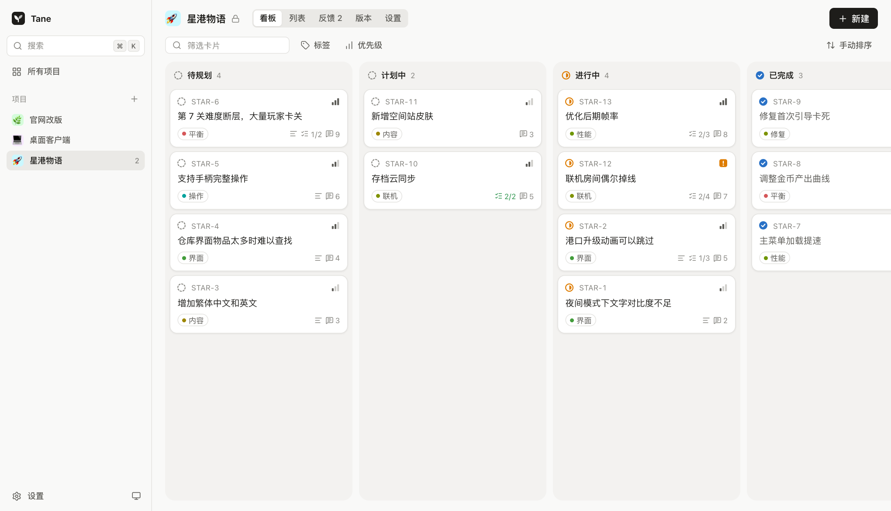

<p align="center">
  
</p>

<h1 align="center">Tane</h1>

<p align="center">
  轻量、快速的看板与反馈收集工具，可以交给你自己的 AI agent 来操作。
</p>

<p align="center">
  <a href="https://github.com/dogxii/tane/stargazers"></a>
  <a href="https://github.com/dogxii/tane/commits/main"></a>
  <a href="LICENSE"></a>
  <a href="https://developers.cloudflare.com/workers/"></a>
  <a href="https://svelte.dev"></a>
</p>

<p align="center">
  <a href="README.md">English</a> | 简体中文
</p>

<p align="center">
  
</p>

Tane（種，意为“种子”）帮你收集大家想要什么，并决定接下来做什么。一位所有者可以管理多个项目，每个项目默认私有，部署在你自己的 Cloudflare 账号上。

## 功能

- **看板和列表视图**：同一份卡片两种看法，支持拖拽、键盘快捷键和 ⌘K 命令面板
- **反馈收件箱**：自动跳过重复内容，按不同的人统计提及数
- **反馈页**：有独立链接，看板保持私有时也能用
- **公开路线图和更新日志**：可以按项目单独开启
- **Agent 接入**：只需一个 Markdown 文件和一个 token，网站本身不运行 AI，也不需要模型密钥
- **足够轻量**：反馈页的 JS 和 CSS 压缩后约 40 KB，不依赖 UI 框架

## 快速开始

需要 Node 22 或更新版本。

```bash
git clone https://github.com/dogxii/tane.git
cd tane
npm install
cp .dev.vars.example .dev.vars
npm run db:local
npm run dev
```

打开 <http://localhost:5173>，用本地密码 `admin` 登录。

## 部署

Tane 运行在 Cloudflare Workers 和 D1 上。

```bash
npx wrangler login
npx wrangler d1 create tane --binding DB --update-config --location apac
npx wrangler secret put ADMIN_PASSWORD
npm run deploy
```

把 `--location` 设为离用户最近的区域：`wnam`、`enam`、`weur`、`eeur`、`apac` 或 `oc`。

线上环境没有默认密码，请设置一个足够长的随机密码。再次运行 `secret put` 可以修改密码，同时会让所有浏览器退出登录。

个人使用完全在 Cloudflare 免费额度之内，免费版每天可用 10 万次 API 请求和 500 万行数据库读取。公开看板的访客在每个边缘节点共用一份缓存 5 分钟的副本，几乎不会消耗数据库额度。

## 接入 Agent

在**设置**里创建一个 token，把生成的那行内容粘贴给你的 agent。这行内容会让 agent 读取 `/agent.md`，里面写明了完整的 API，所以任何能发 HTTP 请求的 agent 都能使用。之后直接用自然语言吩咐就行，比如“把 42 号卡片标记完成，并备注对应的提交”。

如果你更喜欢命令行，`npm link` 后可以使用 `tane`，它是同一套 API 的零依赖封装：

```bash
tane login https://your.site tane_xxx
tane use my-project
tane cards --compact
tane done 42 --reason "shipped in abc123"
```

运行 `tane --help` 查看全部命令。

## 安全与隐私

Agent 的每次改动都会以 token 的名称记录下来，并附上它给出的理由（如果有）。以下操作只有所有者能在网页上完成：

- 公开项目，修改建议提交或反馈页的设置
- 在公开看板上显示卡片。Agent 创建的卡片默认隐藏
- 发布版本，或编辑已发布的版本
- 删除项目，管理 token

公开看板会显示卡片标题、描述、标签、状态、清单、提及数和已发布的版本，不会显示反馈原文、评论、活动记录、关键词、隐藏的卡片和已取消的卡片。由于看板有缓存，你隐藏卡片或把项目改为私有后，访客最多还能看到 5 分钟旧内容。反馈页默认关闭，只展示项目名称和图标。

反馈来自陌生人，对 agent 来说属于不可信输入。API 会把它放在 `untrusted` 字段下，`agent.md` 也要求 agent 把它当作数据处理，但这只能降低提示词注入的风险。请只给读取反馈的 agent 必要的权限。

## 开发

| 命令 | 用途 |
|---|---|
| `npm run dev` | 在本地启动应用和 API |
| `npm test` | 对运行中的开发服务器执行 API 测试 |
| `npm run check` | 类型检查 |
| `npm run build` | 生产构建 |

```
worker/          API：认证、项目、卡片、反馈
migrations/      D1 数据库结构
src/lib/ui/      组件库（访问 /ui 可以浏览）
src/components/  看板、列表、反馈、版本、卡片面板
src/pages/       页面路由
public/agent.md  给 agent 读的说明
cli/tane.mjs     可选的命令行工具
test/            API 集成测试
```

基于 [Hono](https://hono.dev) 和 [Svelte 5](https://svelte.dev) 构建。

## Star 历史

<a href="https://star-history.com/#dogxii/tane&Date">
  <picture>
    <source media="(prefers-color-scheme: dark)" srcset="https://api.star-history.com/svg?repos=dogxii/tane&type=Date&theme=dark" />
    
  </picture>
</a>

## 许可证

[MIT](LICENSE)
